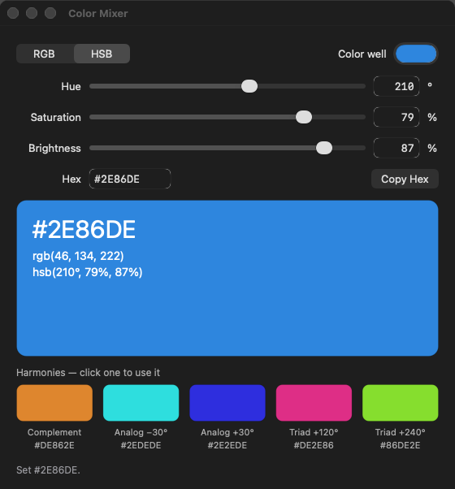

# loup-macos-color-mixer — a color mixer for macOS, in Loup



A sample macOS GUI application written in Loup, built on the
[appkit library](https://github.com/myronccai/loup-macos-appkit) (Loup proxy
classes over AppKit).

## Getting started

### Requirements

- macOS on Apple silicon or Intel, with the Xcode Command Line Tools
  (`xcode-select --install`).
- A Loup toolchain of version **newer than 1.27.0**, with `loup`, `loup-build`,
  `loup-llvm`, `loup-test` and `loup-bootstrap` on `PATH`. This app needs
  fixes made after the 1.27.0 release ([Loup releases](https://github.com/code-craft-ai-company/loup-releases/releases)).
- If linking fails with `tapi error … unknown architecture`, point `SDKROOT`
  at an older SDK, for example
  `export SDKROOT=/Library/Developer/CommandLineTools/SDKs/MacOSX26.5.sdk`.

### Get the code

The app depends on the appkit library through the path dependency
`appkit = { path = "../loup-macos-appkit" }`, so clone both repositories into
the same directory:

```sh
git clone https://github.com/myronccai/loup-macos-appkit
git clone https://github.com/myronccai/loup-macos-color-mixer
cd loup-macos-color-mixer
```

### Build, run, test and self-test

From inside `loup-macos-color-mixer`:

```sh
loup build                                      # build ./loup-macos-color-mixer
./loup-macos-color-mixer                        # run the app (⌘Q or closing the window quits)
loup test --strict src                          # the model's tests
./loup-macos-color-mixer --self-test            # drive the UI, print, quit (compare with selftest.out)
bash ../loup-macos-appkit/run_all.sh loup-macos-color-mixer   # the full gate
```

[Build, run, test](#build-run-test) below has the details.

## What it does

Mix a color and see its harmonies:

- **RGB / HSB sliders.** A segmented control (or the Color menu, ⌘1 / ⌘2)
  switches the three sliders between red, green, blue (0–255) and hue
  (0–360°), saturation and brightness (0–100 %). Each slider has a numeric
  field beside it; the two stay in sync both ways — dragging updates the
  field, and typing moves the slider with every key that leaves a whole
  number in the field (Return or leaving the field then shows the value
  clamped to the channel's range: `300` in Green becomes 255). A key that
  makes the text something else is reported in red in the status line and
  changes nothing more: typing `1`, `2`, `x` in Red leaves Red at 12. A field
  emptied to be retyped waits quietly for the new number (committing it empty
  is reported). The hue slider's right end, 360°, is the same hue as 0° and
  stays at the right end (typing `500` in Hue gives 360°).
- **Hex field.** Shows the color as `#RRGGBB`; type `#RRGGBB`, `RRGGBB` or the
  short `#RGB` (either case) and press Return. An invalid value stays in the
  field and the status line says what is wrong.
- **Swatch and harmonies**, drawn on an `appkit.canvas`: a large swatch
  labelled with the hex, `rgb(…)` and `hsb(…)` values (in dark or light ink,
  whichever reads better on the color), and a row of five harmony swatches —
  the complement (hue +180°), two analogous colors (−30°, +30°) and two
  triadic colors (+120°, +240°) — each with its name and hex value. Click a
  harmony swatch to make it the current color (Color ▸ Use Complement, ⌘K,
  does that for the complement).
- **Color well**, kept in sync with the sliders; click it to pick a color in
  the system color panel.
- **Copy Hex** (button, or Color ▸ Copy Hex, ⇧⌘C) puts `#RRGGBB` on the
  clipboard.
- **Status line** under the canvas: what just happened, in the system grey,
  or what is wrong, in the system red (both follow light and dark mode).

Moving through a grey or black keeps the hue and saturation you had: drag
brightness to 0 and back and the color returns, not red.

## Build, run, test

Requires macOS, the Xcode Command Line Tools and the Loup toolchain (newer than
1.27.0) on `PATH`, with [loup-macos-appkit](https://github.com/myronccai/loup-macos-appkit)
checked out beside this repository (see [Getting started](#getting-started)).

```sh
loup build                               # self-hosted toolchain → ./loup-macos-color-mixer
loup-bootstrap build --target native     # or Stage0, the same binary
./loup-macos-color-mixer                      # the app (⌘Q or closing the window quits)
./loup-macos-color-mixer --self-test [shot.png]   # drive the UI, print, (snapshot,) quit
loup test --strict src                   # the model's tests (interpreted)
```

`bash ../loup-macos-appkit/run_all.sh loup-macos-color-mixer` (the gate, which
lives in the appkit repository and treats the directory holding both checkouts
as its workspace) does all of it: both builds, both
self-tests against `selftest.out`, and `loup test`; `--screenshots` also
rewrites `screenshot.png`. Run GUI binaries under `lldb` while developing (the
gate does) so a crash prints a backtrace.

### The self-test

`--self-test` runs invisibly (no Dock icon, no focus, a transparent window that
still lays out and draws). Once the window is up it uses the app through its
controls: drags sliders (value + action); types into the channel fields and
the hex field key by key (`TextField.selectAll` / `typeKey`, one change
event per key, then `submit` for Return) — a value clamped live and then on
Return, `1` `2` `x` (12 applied, then rejected), a field cleared to be
retyped, an invalid hex and the short form; switches to HSB with the
segmented control; drags the hue to its right end and types 500 in it;
drags brightness to 0 and back; clicks a harmony swatch with a mouse event on
the canvas; picks a color through the color well's action; chooses Color ▸
RGB Sliders and Use Complement (`MenuItem.perform`); presses ⌘2, ⌘K and ⌘1
(`Window.sendKey`); and copies the hex with the Copy Hex button and with
⇧⌘C (saving and restoring the clipboard around it). After each step it
prints what the controls show — mode and the Color menu's check marks,
channel names, field texts, slider values and ranges, hex field, color well,
status line and its color — and the colors of the canvas pixels under the
large swatch and each harmony swatch, read from one rendering of the canvas
into an sRGB bitmap (`View.render`, `Bitmap.colorAt`). The output is
`selftest.out`; both drivers must print it exactly.

## Structure

| File | Mode | What it is |
|---|---|---|
| `src/main.lphc` | `host.native` | The window, the menu, the handlers that keep every control in sync with the model, the canvas drawing, and the `--self-test` driver. |
| `src/colormodel.loup` | `host.dual` | The model, with no AppKit: `Rgb` / `Hsb` / `Mixer` values, RGB ↔ HSB ↔ hex conversions, the harmonies, channel names and ranges, and parsing of typed values. Every state change returns a new `Mixer`. |
| `src/colormodel_test.lpscr` | `host.scripted` | `loup test` tests of the model: conversions, round trips, greys, hue wrap-around, the hue slider's 360° end, clamping, valid and invalid hex, harmonies, the mixer's state changes. |
| `selftest.out` | | The exact output of `--self-test`. |
| `loup-macos-color-mixer.lppkg` | | The manifest: native build of `src/main.lphc`, the `appkit` path dependency, `framework = ["AppKit"]`. |

`apply(mixer, source)` in `main.lphc` is the one place controls are written:
it stores the new state and rewrites every control from it, except a channel
field the user is still typing in and the color well while its panel is in
use.

## appkit modules used

From the [appkit library](https://github.com/myronccai/loup-macos-appkit) (see
each module's header comment and its
[docs/](https://github.com/myronccai/loup-macos-appkit/tree/main/docs), checked
out at `../loup-macos-appkit/docs/`):

- `appkit.app` — `appInit` (App / Edit / Window menus), `Window`
  (`clearFocus`, `sendKey`, `render`), `Menu` / `MenuItem` / `addMenu` (the
  Color menu: `addItem`, `addItemWithModifiers` with `MOD_SHIFT_COMMAND`,
  check marks with `setChecked` / `checked`, `perform`), `View.render` /
  `Bitmap.colorAt` / `pixelHex` (canvas pixels), `View.setCompressionResistance`
  with `PRIORITY_REQUIRED` (the channel fields keep their height beside the
  stretched sliders), `isDarkMode` (the canvas captions), `after`, `run`,
  `quit`, `isSelfTest`.
- `appkit.controls` — `SegmentedControl`, `Slider`, `TextField` (typed with
  `selectAll` / `typeKey` / `submit` in the self-test), `Label` (the status
  line's `applyTextColor` / `textColorRef` with `systemColor(COLOR_SYSTEM_GRAY)`
  and `COLOR_SYSTEM_RED`), `Button`, `ColorWell`, `monospacedFont`, `Color`,
  `TEXT_RIGHT`.
- `appkit.layout` — `VStack` / `HStack` (`addExpanding` for the sliders and
  the canvas, `addSpacer`), `setMinSize`, `layoutNow`.
- `appkit.canvas` — `Canvas` (`onDraw`, `onMouseDown`, `sendMouse`, `redraw`)
  and `Graphics` (rounded rectangles, text, `textWidth`).
- `appkit.dialogs` — `copyText`, `pasteText`, `saveClipboard`,
  `restoreClipboard`.

The app makes no raw Objective-C calls: the proxies cover everything it does.

## License

MIT; see [LICENSE](LICENSE). Built on
[loup-macos-appkit](https://github.com/myronccai/loup-macos-appkit).
